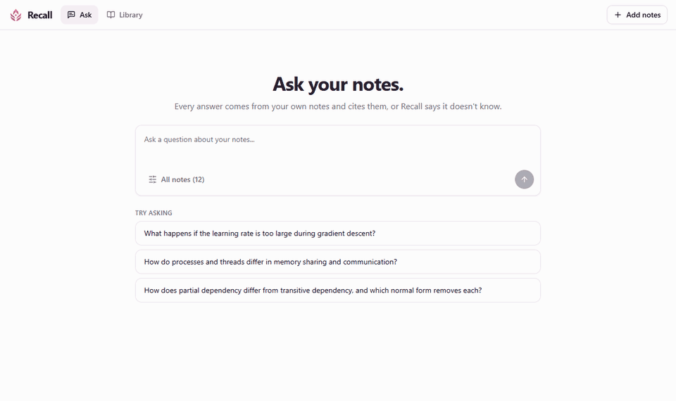
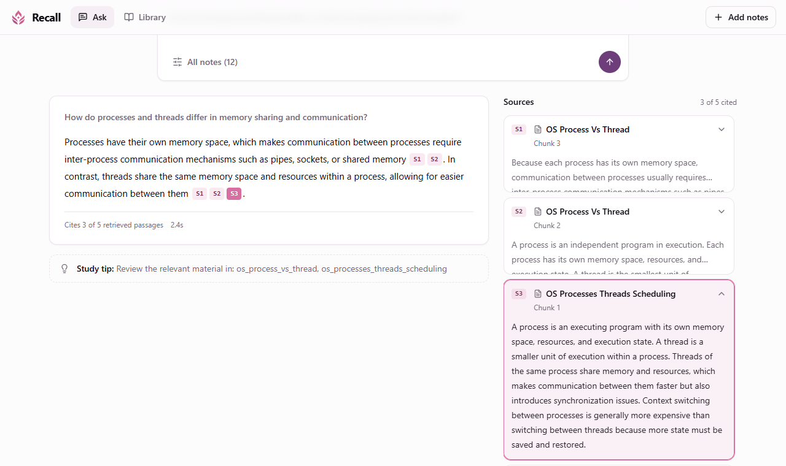
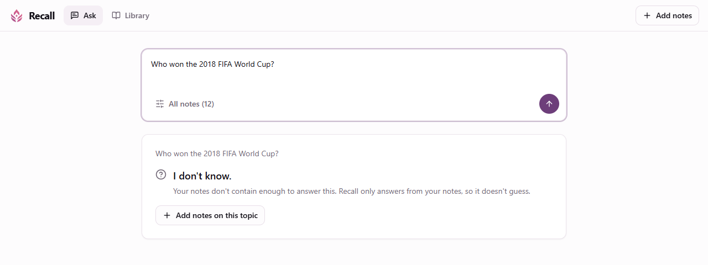
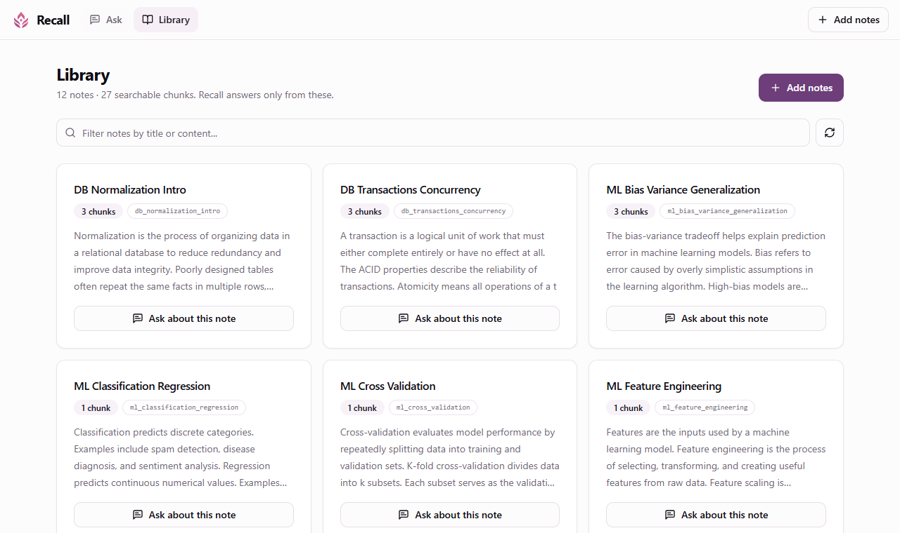
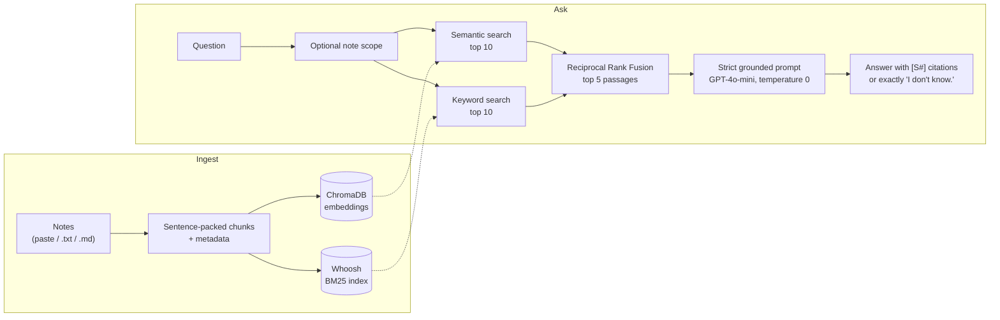

# Recall

**A study assistant that answers only from your own course notes: every claim cites the passage it came from, and when the notes don't support an answer, Recall says "I don't know."**

[](https://github.com/nour0205/Recall/actions/workflows/ci.yml)


[](LICENSE)



General-purpose chatbots answer course questions from their own training data. The answer may differ from what your lecturer taught, and you can't tell which parts came from your material. Recall does the opposite. Your notes are its only source of truth, and every answer shows its evidence so you can check it yourself.

I built Recall as a hybrid-search RAG system and treated it as an engineering problem: each design choice was tested on a hand-labelled benchmark before it reached production.

## What Recall does

- **Answers with clickable citations.** Ask in plain language and get a short answer with `[S1]`, `[S2]`… markers. Clicking one opens the exact passage in the source panel.
- **Refuses instead of guessing.** If your notes don't contain the answer, the response is exactly `I don't know.`, with no invented extras. All three out-of-scope test questions were refused.
- **Searches by meaning *and* by exact terms.** Semantic search (OpenAI embeddings in ChromaDB) and keyword search (BM25 in Whoosh) run side by side and are merged with Reciprocal Rank Fusion. Paraphrased questions and exact technical terms are both covered.
- **Shows what it used.** The source panel marks which retrieved passages the answer cites and which it didn't, so weak retrieval is visible rather than hidden.
- **Scopes questions to specific notes.** Ask about one lecture or a chosen set, or search the whole library.
- **Manages a personal library.** Add notes by pasting text or uploading `.txt`/`.md` files, or delete them. Duplicates are detected by content hash, and adding a note is all-or-nothing across both search indexes.

| Every answer is checkable | No support, no answer | Your library |
|---|---|---|
|  |  |  |

## Results

I compared four answer-generation prompts on the same 19 questions and the same retrieved passages, so only the prompt changed between runs. Every answer was reviewed by hand, claim by claim, against a fixed rubric. The baseline is a conventional "answer from the context and cite your sources" prompt. Strict v2 is the prompt Recall uses in production.

| Measured on 19 benchmark questions | Baseline prompt | **Recall (Strict v2)** |
|---|---:|---:|
| Answers fully supported by the notes | 5 / 19 (26%) | **18 / 19 (95%)** |
| Answers adding claims the notes don't support | 14 / 19 | **1 / 19** |
| Citations that actually support their claim | 3 / 17 (18%) | **15 / 16 (94%)** |
| Out-of-scope questions correctly refused | 3 / 3 | **3 / 3** |
| Required points covered (16 answerable questions) | **16 / 16** | 14.5 / 16 |
| Mean generation latency | 2.4 s | **1.1 s** |

The baseline covered every required point but padded most answers with plausible material that wasn't in the notes, often with a citation attached. Strict v2 removed almost all of that at a small cost in completeness. That trade-off is measured, not assumed. Strict v2 is the best balance on this benchmark, not a universally best prompt.

<details>
<summary>All four prompts compared</summary>

| Prompt | Groundedness | Mean completeness | Citation correctness | Unsupported elaboration |
|---|---:|---:|---:|---:|
| Baseline | 5/19 (26%) | 16/16 (100%) | 3/17 (18%) | 14/19 |
| Strict v1 | 19/19 (100%) | 13.5/16 (84%) | 15/15 (100%) | 0/19 |
| Balanced v2 | 15/19 (79%) | 15.5/16 (97%) | 12/16 (75%) | 4/19 |
| Strict v2 | 18/19 (95%) | 14.5/16 (91%) | 15/16 (94%) | 1/19 |

Strict v2 is the production prompt. Strict v1 was the most grounded, but it under-answered and once refused a question it could answer. Balanced v2 recovered completeness but reintroduced unsupported claims. Citation correctness excludes cases labelled not applicable, so its denominators differ. Per-case details are in the [final comparison](evaluation/results/generation_prompt_ablation_comparison_final.md).

</details>

**End to end, through the real `/ask`.** On a fresh install of the same notes, with live retrieval: 17/19 answers grounded, 14.25/16 required points, 3/3 out-of-scope questions refused and 0 answerable ones refused. Unchanged answers keep my human labels; the rest were scored with an [LLM judge calibrated against them](evaluation/JUDGE_CALIBRATION.md) and adjudicated with the written labelling conventions. The one-answer gap from the table above comes from a stricter labelling rule adopted since (dropping "usually" now fails), which the isolated answer fails too ([end-to-end report](evaluation/END_TO_END_EVALUATION.md)).

**Design decisions came from measurement too:**
- **Rejected a heuristic reranker.** It made rankings worse on 6 of 16 questions and better on none (MRR 0.802 → 0.693).
- **Kept a neural cross-encoder (MiniLM) out of production, for now.** On 12 short notes it was close to plain fusion in quality but added about 0.65 s of CPU latency per query. Rerankers matter most on large corpora, so it gets re-tested when PDF ingestion grows the library.
- **Production uses plain Vector + BM25 + RRF fusion, kept for robustness, not because it scored higher.** On the evidence labels, vector-only, keyword-only and hybrid search all put every required passage in the top 5 for all 16 answerable questions, and differ on single questions. This benchmark is too easy to separate them ([rescoring](evaluation/results/evidence_rescore_20261013T141146718706Z.md)).
- **Removed an LLM intent planner.** With and without it, the answering model received byte-identical prompts for all 19 questions, while it took about 40% of response time. Removing it cut mean latency from about 2.1 s to 1.2 s ([ablation](evaluation/PLANNER_ABLATION.md)).

> **Scope:** a small, hand-built benchmark of 19 questions (16 answerable, 3 deliberate refusals) over 12 short notes on machine learning, operating systems and databases. The numbers describe this set; I make no statistical-significance claims. Full methodology: [retrieval report](evaluation/MILESTONE_1_RETRIEVAL_EVALUATION.md) · [generation report](evaluation/MILESTONE_2_GENERATION_EVALUATION.md) · [end-to-end and judge report](evaluation/MILESTONE_3_END_TO_END.md).

## How it works



1. **Ingest.** Notes are split into sentence-packed chunks of up to 500 characters, each prefixed with the previous chunk for context. Chunks are embedded with `text-embedding-3-small` and written to both a vector index (ChromaDB) and a keyword index (Whoosh BM25). Both indexes share one chunk ID.
2. **Scope.** Every note is searched by default; the UI can limit a question to chosen notes.
3. **Retrieve.** Semantic and keyword search each return 10 candidates. Reciprocal Rank Fusion (k = 60) merges them, and the top 5 passages go to the model in ranked order.
4. **Generate.** The Strict v2 prompt allows only facts stated in the passages, requires a `[S#]` citation for each claim, and requires the exact sentence `I don't know.` when support is missing. The backend normalizes any refusal to that sentence and returns no sources with it.
5. **Show.** The React interface turns every `[S#]` into a button that opens and highlights that passage in the source panel.

## What I learned building it

- **A citation is not evidence.** The baseline prompt cited sources in almost every answer, yet 14 of 19 answers contained claims the cited passage didn't support. I learned this only by checking each claim by hand, which is why the evaluation scores groundedness and citation correctness separately.

  > **Q:** What happens if the learning rate is too large during gradient descent?
  > **Baseline:** "A **learning rate** that is too large results in overshooting the optimal parameter values, leading to instability in the training process [S1]." *(The notes don't mention overshooting or instability.)*
  > **Recall:** "A learning rate that is too large may cause divergence [S1]." *(Exactly what the notes say, including "may".)*

- **Grounding and completeness pull against each other.** My first strict prompt reached 100% groundedness but under-answered and once refused a question it could answer. I fixed the false refusal and recovered completeness in Strict v2, accepting one remaining unsupported claim. I chose that trade-off deliberately, with the numbers in front of me.
- **More complexity isn't automatically better.** Two rerankers sounded like upgrades. One made results worse; the other cost latency for no clear gain. Both stay out of production. An LLM intent planner looked like a step toward an agent, but fingerprinting the prompts showed it never changed what the answering model saw, so I removed it.
- **Temperature 0 is not deterministic.** From byte-identical prompts, one run defined two database concepts wrongly and the next run correctly. On 19 questions, a single run can move a score by a case from chance alone, so comparisons need several runs.
- **Labels have to match the data.** Overlapping chunks meant the same evidence existed under several chunk IDs, so "find chunk X" scoring under-credited correct retrievals. I moved to *evidence groups* (any equivalent chunk counts, and every required part must be covered).
- **Evaluation finds bugs that tests miss.** Running the benchmark showed that BM25 was parsing natural-language questions as query syntax. It now searches the literal terms.
- **Make results reproducible.** Retrieved contexts were frozen so that only the prompt varied between runs. Benchmark and prompt files are pinned by SHA-256 hashes. Saved scores are recomputed offline in CI on every pull request.

## Limitations and next steps

These are what I'd want a reviewer to know:

- **End-to-end scores rest on a small benchmark and a partly trusted judge.** The production `/ask` path is now [evaluated end to end](evaluation/END_TO_END_EVALUATION.md) (17/19 grounded, 3/3 refusals), and an [LLM judge is calibrated](evaluation/JUDGE_CALIBRATION.md) against my labels (kappa 0.82 on required points, 0.75 on groundedness), and on 20 new, held-out answers it matched my required-point judgments 32 out of 32. But it consistently misses subtle unsupported elaborations, and its groundedness has not yet been tested on held-out answers that contain failures, so its "grounded" verdicts still need human review. **Next:** a larger, freshly labelled benchmark, which also gives the judge a held-out test.
- **Retrieval decisions were made at a small scale.** With 12 short notes (27 chunks), every retrieval method finds the required evidence, so the benchmark cannot show that hybrid search or a reranker helps. The original exact-chunk labels even favoured vector-only search (MRR 0.854 vs 0.802 for hybrid), an artefact that disappears with evidence-group labels. **Next:** harder retrieval questions (paraphrases with no shared words, exact technical terms) and a larger corpus, then re-test hybrid search and a cross-encoder reranker.
- **Retrieved context contains near-duplicates.** Each chunk includes the previous chunk for context, so the top 5 passages can repeat text. In the demo above, two of the five passages are neighbouring chunks of the same note and share text. **Next:** sentence-level overlap plus de-duplication, measured against the benchmark.
- **Answers are short (about 22 words on average).** That's good for grounding but thin for studying. **Next:** a cited short answer first, with a grounded "explain more" option.
- **It's a local prototype.** It ingests plain text only (no PDF yet), has no accounts or deployment, and uses OpenAI only.

## Run it locally

You need an OpenAI API key; asking questions and adding notes make small paid API calls.

**With Docker**

```sh
cp .env.example .env        # then put your OPENAI_API_KEY in .env
docker compose up --build -d
docker compose exec backend python -m app.seed_demo   # optional: load the demo notes
```

Open the app at <http://127.0.0.1:5173> and the API docs at <http://127.0.0.1:8000/docs>. Notes and indexes persist in Docker volumes.

**Without Docker** (Python 3.12, Node.js 20+)

```sh
python -m venv .venv
.venv\Scripts\Activate.ps1           # macOS/Linux: source .venv/bin/activate
pip install -r requirements.txt
cp .env.example .env                 # add your OPENAI_API_KEY
python -m app.seed_demo              # optional: load the 12 demo notes
uvicorn app.api.main:app --reload    # API on :8000

# in a second terminal
cd recall-frontend
npm ci
npm run dev                          # app on :5173
```

`app.seed_demo` loads the [12 demo notes](demo_notes/) the benchmark was built on, so the "Try asking" examples work straight away. To use your own material instead, skip it and click **Add notes** in the app.

To check that the vector and keyword indexes hold the same chunks, run `python -m app.check_indexes` (add `--repair` to fix any drift; no API calls).

**Tests and evaluation checks** (offline, no API key needed):

```sh
python -m unittest discover -s tests       # 218 tests
python -m evaluation.validate_benchmark    # benchmark schema checks
python -m evaluation.verify_saved_results  # recompute saved scores from saved runs
```

CI runs these checks, plus the frontend typecheck and build and both Docker image builds, on every pull request and every push to `main`.

## Tech stack

| Layer | Tools |
|---|---|
| Backend | Python 3.12, FastAPI, Pydantic |
| Retrieval | OpenAI `text-embedding-3-small`, ChromaDB, Whoosh BM25, Reciprocal Rank Fusion |
| Generation | GPT-4o-mini (temperature 0), versioned grounded prompt |
| Frontend | React 18, TypeScript, Vite, Tailwind CSS, shadcn/ui (Radix) |
| Evaluation | Versioned JSON benchmarks, deterministic metrics, human-review tooling; optional sentence-transformers for reranker experiments |
| Delivery | Docker Compose, GitHub Actions CI |

## Repository layout

| Path | What's there |
|---|---|
| [`app/`](app/) | API, ingestion, hybrid retrieval and grounded generation |
| [`recall-frontend/`](recall-frontend/) | React interface |
| [`evaluation/`](evaluation/) | Benchmarks, metrics, experiment runners, human-review tools and saved results |
| [`tests/`](tests/) | Offline unit and API tests (model and indexes stubbed) |
| [`docs/`](docs/) | Milestone summaries, production-promotion notes and README images |

## Roadmap

- [x] **Retrieval evaluation:** vector, BM25, hybrid and two rerankers, compared on hand-labelled evidence
- [x] **Generation evaluation:** four prompts, human-reviewed for groundedness, completeness, citations and refusals
- [x] **Production promotion:** the measured retrieval and prompt configuration, with regression tests, CI and Docker
- [x] **Interface redesign:** clickable citations, source panel, refusal state, note scoping and library
- [x] **End-to-end evaluation:** the production `/ask` path on a reproducible demo corpus, an LLM judge calibrated against the human labels, and the planner ablation
- [ ] A larger benchmark with harder retrieval questions, and a held-out test of the judge
- [ ] PDF ingestion with page-level citations, structure-aware chunking and French-language support
- [ ] A tool-using study agent (search, read, quiz) evaluated against plain RAG
- [ ] Tracing, a provider switch and a hosted demo

## License

[MIT](LICENSE) © 2026 Nour Kouider
